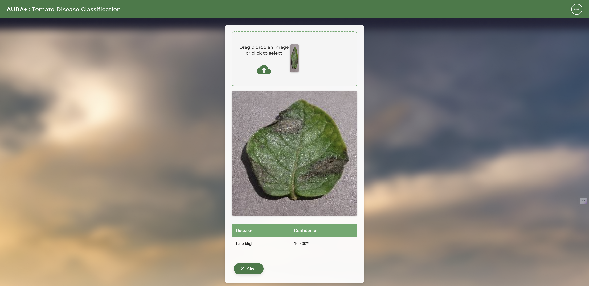
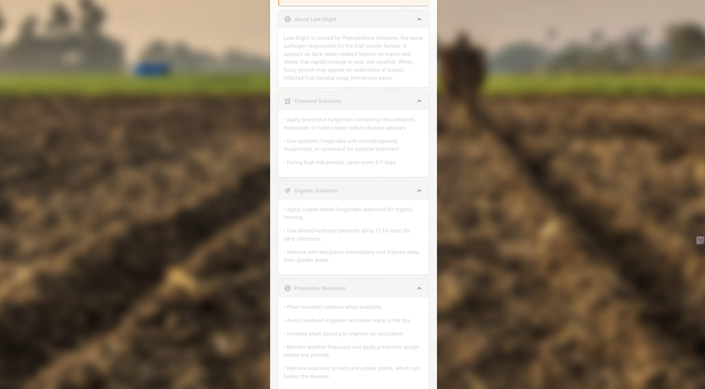

# 🥔 Potato Disease Classification 🥔

  
  

  <h3>Detect Early Blight, Late Blight, and Healthy Potato Plants with Deep Learning</h3>

  
  
  
  
  

## 🌱 Overview

This deep learning-based project is designed to classify potato plant conditions using image data. The model accurately detects:

🦠 Early Blight — caused by Alternaria solani
🍄 Late Blight — caused by Phytophthora infestans
✅ Healthy — normal, disease-free potato plants
Timely disease detection empowers farmers to act early, preventing major crop losses and ensuring better yields.

  

## 🔬 Why It Matters

Potato crop diseases are responsible for massive agricultural losses worldwide. Immediate identification is critical because:

Late blight can wipe out fields within days
Early blight can reduce yields by up to 30%
Both thrive and spread quickly under moist, humid conditions
This tool provides a fast, accessible solution to detect diseases before they become unmanageable — enabling proactive treatment and improved food security.

